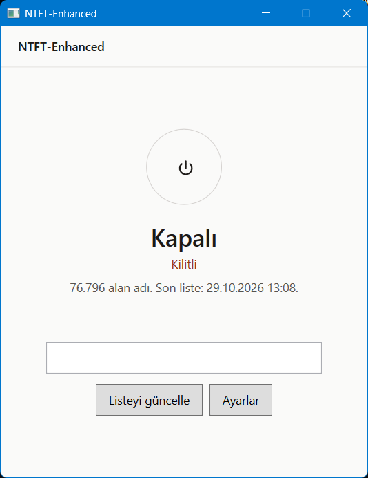
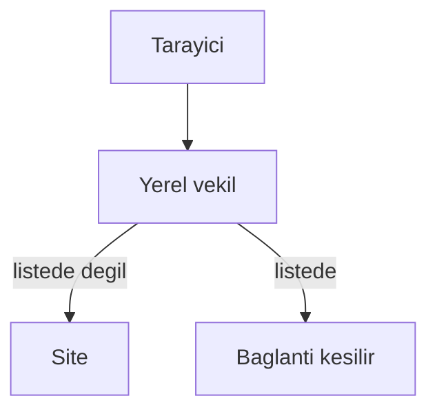

# NTFT-Enhanced

Windows 10 ve 11 için ücretsiz, parola kilitli bir pornografi filtresi. Lisans anahtarı yoktur. Tarayıcı uzantısı henüz yoktur.

English: a free Windows porn filter with a password lock. No license key. The browser extension and malware list are on the [roadmap](ROADMAP.md), not in the build yet.



Bu görüntü 29 Ekim 2026 durumudur. Koruma kapalı, kilit duruyor. Liste inmiş: 76.796 alan adı.

## Şu an ne çalışıyor

- Liste [StevenBlack/hosts](https://github.com/StevenBlack/hosts) deposunun yalnızca pornografi dosyasıdır: `alternates/porn-only/hosts`. Reklam ve zararlı yazılım listesi alınmaz.
- İndirme HTTPS ile gelir ve GitHub blob SHA-1 özeti ile doğrulanır. Doğrulama tutmazsa eski liste kalır.
- Liste hosts dosyasına yazılmaz. On binlerce satır Windows’un ad çözümlemesini yavaşlatır. Eski bir NTFT bloğu hosts dosyasında duruyorsa koruma açılınca o blok silinir. Sizin diğer satırlarınız kalır.
- Koruma açıkken yerel bir vekil, tarayıcının `CONNECT` satırındaki alan adına bakar. Sayfanın şifresi çözülmez. Vekil durursa PAC doğrudan bağlanır, internet kesilmez.
- Engel olunca bildirim “Bir bağlantı engellendi” der. Alan adı bildirimde, günlükte ve durumda yazılmaz.
- Parola PBKDF2-HMAC-SHA256 ile durur. Düz metin saklanmaz. Kurtarma anahtarı bir kez gösterilir. Beş yanlış denemeden sonra bekleme başlar ve yeniden açılışta da durur.
- Liste elle güncellenir. Kendiliğinden güncelleme varsayılan olarak yedi günde bir çalışır. Kilitliyken bunu kapatmak parola ister. Listeyi yenilemek parola istemez.
- Arayüz ortada bir güç düğmesi gösterir. **Koruma açık** ve **Kilitli** ayrı yazılır.

## Nasıl keser



İsteğe bağlı Cloudflare Family DNS (`1.1.1.3` / `1.0.0.3`) yetişkin alan adlarını çözümlemede keser. Kurulumda kendiliğinden açılmaz. `microsoft.com` çözülmezse eski DNS geri gelir. Ayrıntı [yol haritasında](ROADMAP.md).

## Ne yapmaz

- YouTube kısıtı yoktur.
- Reddit, X, Discord ve Telegram’ın kendisi listede yoksa açık kalır.
- Siteye “Engellendi” sayfası basılmaz. Bunu eklenti yapacak. Şimdiki vekil sayfanın içine yazmaz.
- HTTPS’in şifresi çözülmez. Kök sertifika kurulmaz.
- Çekirdek sürücüsü, görev yöneticisini kilitlemek ve tarayıcıyı zorla kapatmak yoktur. Sonuncusu eklenti kilidiyle gelecek.
- Yönetici, `services.msc` üzerinden servisi durdurabilir. Bu gizlenmez. Kurtarma [KURTARMA.md](KURTARMA.md) içindedir.
- Helium, Chrome politikasını yok sayabilir. Elle denenecek. Tutmazsa Firefox tabanlı tarayıcılar kullanılır.

## Kurulum

```powershell
.\build.ps1
```

`artifacts\publish\NTFT-Enhanced-Setup.exe` yönetici onayı ister. Kurulum hosts dosyasını değiştirmez. Pencereden **Korumayı aç** deyince liste iner ve yerel vekil başlar.

Arkadaş **Ayarlar → Kilidi kur** ile parolayı iki kez yazar. Kurtarma anahtarı bir kez gösterilir. Makine dışında saklanır.

## Geliştirme

.NET 8. Arayüz WPF, servis LocalSystem, kurulum ayrı bir programdır. Ayrıntı [ROADMAP.md](ROADMAP.md) dosyasındadır.

## Lisans

Uygulama kodu MIT. Liste lisansları [THIRD_PARTY_NOTICES.md](THIRD_PARTY_NOTICES.md) içindedir.
